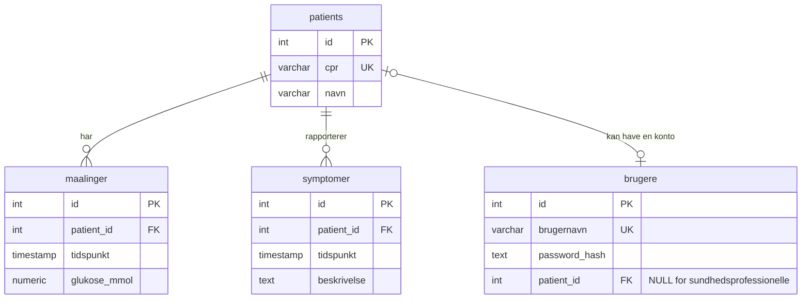

# Projektlog – Lektion 19 (Øvelse 3: Login i gruppeprojektet)

## Formål

Projektet har login med sessioner. En patient kan se egne målinger og symptomer
og rapportere egne symptomer. Sundhedsprofessionelle kan se patientlisten og
arbejde med patientdata.

Der bruges kun syntetiske testbrugere og testdata. Brug aldrig rigtige
patientoplysninger eller adgangskoder i projektet.

## Brugertyper og adgang

- En sundhedsprofessionel har en brugerkonto uden `patient_id`.
- En patientkonto er knyttet til én række i `patients` via `patient_id`.
- Rollen bestemmes ved login ud fra, om brugeren har et `patient_id`.
- Patienter må kun hente egne målinger og symptomer og kun rapportere symptomer
  for sig selv.
- Patientlisten og oprettelse af patienter er forbeholdt
  sundhedsprofessionelle.

## Datamodel

Adgangskoder gemmes som bcrypt-hashes. `brugere.patient_id` er valgfri for
sundhedsprofessionelle, og databasen tillader højst én brugerkonto pr. patient.

## Loginforløb

1. Klienten sender brugernavn og adgangskode til `POST /api/login`.
2. Serveren finder brugeren og sammenligner adgangskoden med dens hash.
3. Ved succes opretter serveren en session og sender en session-cookie.
4. `GET /api/me` returnerer den aktuelle bruger, hvis sessionen er gyldig.
5. `POST /api/logout` afslutter sessionen.

Login og sessioner håndteres i `server.js`; databaseopslag håndteres i
`brugere.js`. Login-siden ligger i `public/index.html`, og fælles
sessionstjek/logout ligger i `public/Login/Auth.js`.

## Testskema

Requests findes i `api.http`. Testene blev kørt mod den lokale server på
`http://localhost:3000` den 11/11-2026 med syntetiske testkonti. Én syntetisk
symptomregistrering blev oprettet og gemt i den konfigurerede database.

| # | Request | Forventet | Fik |
|---|---------|-----------|-----|
| 1 | `POST /api/login` uden adgangskode | 400 | 400 |
| 2 | `POST /api/login` med forkert adgangskode | 401 | 401; ukendt bruger gav samme fejlbesked |
| 3 | `POST /api/login` med korrekt testlogin | 200 og `Set-Cookie` | 200 og cookie; intet password-hash i svaret |
| 4 | `GET /api/me` efter login | 200 og samme brugernavn | 200 |
| 5 | `POST /api/symptomer` uden login | 401 | 401 |
| 6 | `POST /api/symptomer` som sundhedsprofessionel med gyldig body | 201 | 201; syntetisk række gemt |
| 7 | Patient henter egne målinger | 200 | 200 |
| 8 | Patient forsøger at hente en anden patients målinger | 403 | 403 |
| 9 | Patient rapporterer symptom for en anden patient | 403 | 403 |
| 10 | `POST /api/logout`, derefter `GET /api/me` | 204, derefter 401 | 204, derefter 401 |
| 11 | Genstart serveren, derefter `GET /api/me` | 401 (lokal MemoryStore-session er væk) | 401 |

## Resultat

Alle testene i skemaet bestod. Derudover gav patientens forsøg på at hente
patientlisten og oprette en patient 403, mens en sundhedsprofessionel kunne
hente patientlisten. Sessionslageret er Express' standard MemoryStore; det er
egnet til lokal afprøvning, ikke til deployment.
