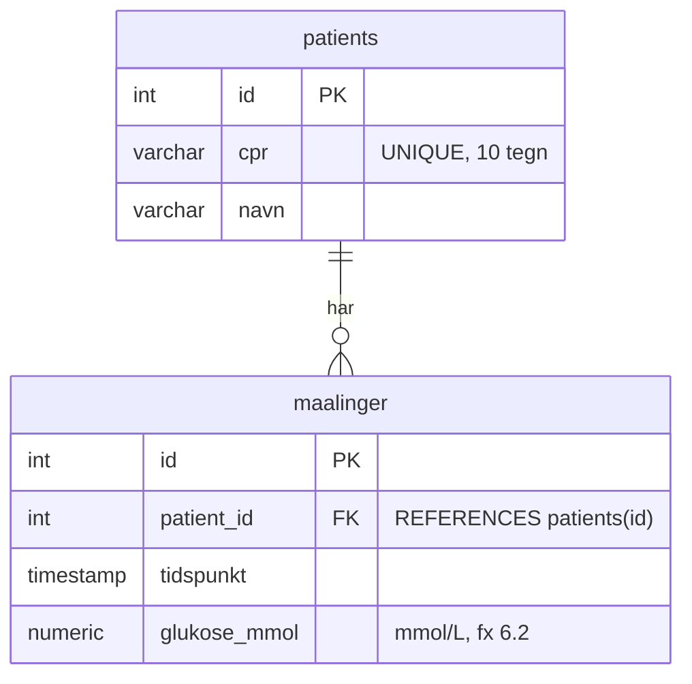

# Projektlog – Lektion 15 (database)

## ER-diagram

Én patient kan have mange glukosemålinger. Hver måling hører til præcis én patient (kragefoden ved `maalinger`).
`glukose_mmol` er `NUMERIC(4,1)` i stedet for `INT`, fordi glukose måles med én decimal (fx 6.2 mmol/L).

## Database

- **server.js:** Express-serveren med frontend og `/api/patients`. Den er uændret i lektion 15 og har endnu ingen forbindelse til databasen. Patienterne ligger stadig i en liste i koden. Den kobles på Neon i lektion 17 via `DATABASE_URL`, og connection-stringen kommer aldrig i koden.
- **Gruppens Neon-projekt `diabeto`** (AWS Europe Central 1, Frankfurt, database `neondb`): tabellen `patients` med de fem syntetiske testpatienter og tabellen `maalinger` med syntetiske glukosemålinger. `maalinger.patient_id` er en fremmednøgle til `patients(id)`.
- **Ejer:** Bardy (Baryalay Ayoubi) ejer projektet på sin Neon-konto. Resten af gruppen får adgang via connection-stringen, som er delt i en privat kanal og gemt uden for repoet.

## SQL brugt i øvelse 3

Se `db/schema.sql`.
